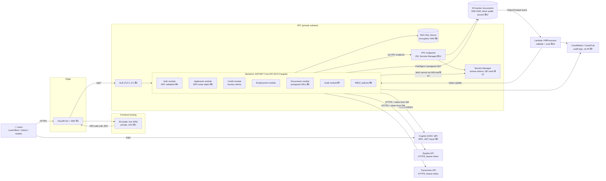
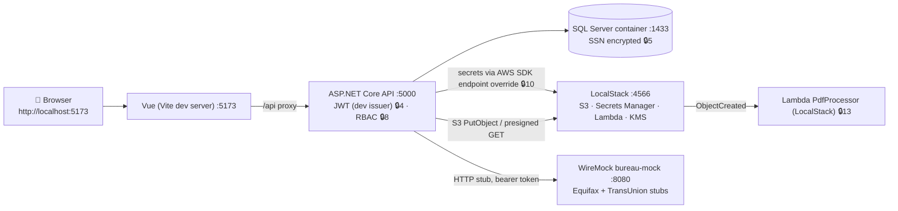
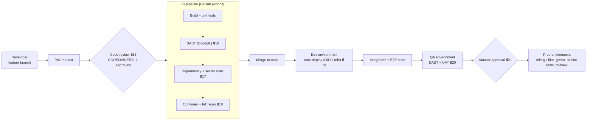
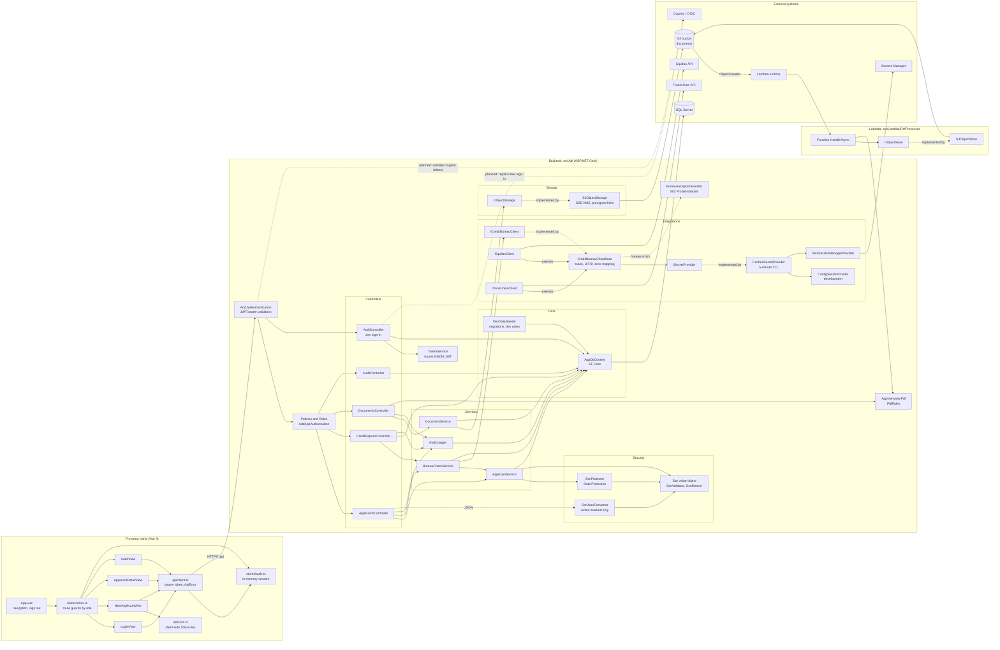

# Architecture

Written for: engineers and reviewers evaluating the security design and deploy flow.

Security checkpoints are marked with 🔒 and numbered. The same numbers appear in the diagrams and the table at the end.

## 1. Production architecture (AWS)

### Notes
- Bureau calls leave the VPC through a NAT gateway with an egress allowlist 🔒14.
- The API runs under an IAM task role. No access keys are stored in code, config, or images 🔒10.
- The SSN is sent to bureaus only in the request body over TLS. It never appears in URLs, logs, or the browser 🔒5.

## 2. Localhost architecture

The same flow runs on a developer machine. External services are replaced with local emulators.

## 3. Deploy flow

Each environment has its own AWS account, its own Secrets Manager entries, and its own KMS key. GitHub Actions assumes an OIDC role per environment, so no long-lived AWS keys are stored in GitHub 🔒19.

## 4. Security checkpoints

| # | Control | Where it is enforced |
|---|---|---|
| 1 | WAF rules, TLS at the edge | CloudFront + WAF |
| 2 | Private S3 bucket, origin access control | S3 static hosting |
| 3 | TLS 1.2+, HTTPS redirect, HSTS | ALB + API middleware |
| 4 | JWT validation (issuer, audience, expiry), MFA at IdP | API auth module, Cognito |
| 5 | SSN validation, masking, encryption at rest | `Ssn` value object, `SsnMasker`, data layer |
| 6 | Short-lived presigned URLs (≤5 min) | Documents module |
| 7 | Audit log, PII-free logging | Audit module, Serilog masking |
| 8 | Role-based authorization policies | Controllers and policies |
| 9 | Encrypted database, KMS key | RDS |
| 10 | Secrets from Secrets Manager via IAM role, no secrets in code | `ISecretProvider` |
| 11 | Private networking, VPC endpoints | VPC |
| 12 | Block public access, SSE-KMS | S3 documents bucket |
| 13 | File type and size validation, PDF scan | Lambda PdfProcessor |
| 14 | Egress allowlist to bureau hosts | NAT / security groups |
| 15 | Required PR review, CODEOWNERS | GitHub branch protection |
| 16 | SAST (CodeQL) | CI |
| 17 | Dependency vulnerability and secret scanning | CI |
| 18 | Container and IaC scanning | CI |
| 19 | OIDC federation, least-privilege deploy role | Deploy pipeline |
| 20 | DAST and security sign-off | QA environment |
| 21 | Manual approval gate | Prod deploy |

## 5. Component diagram

Components as implemented in `web/`, `src/Api`, `src/Lambda/PdfProcessor`, and `src/Shared/AppInterview.Pdf`. Arrows point from the caller to the component it uses. The dashed box is planned, not built.

