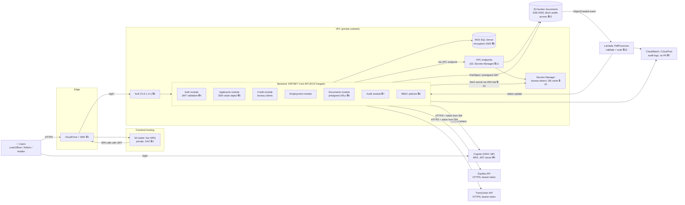
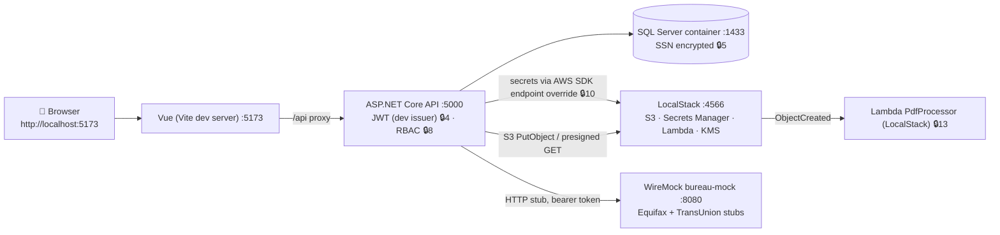
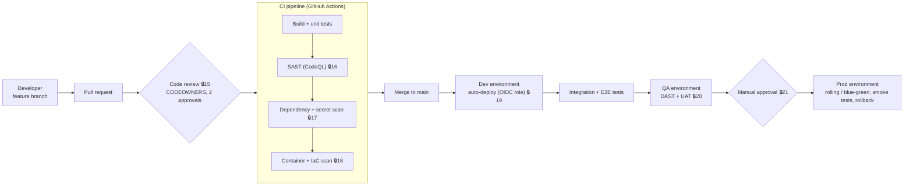
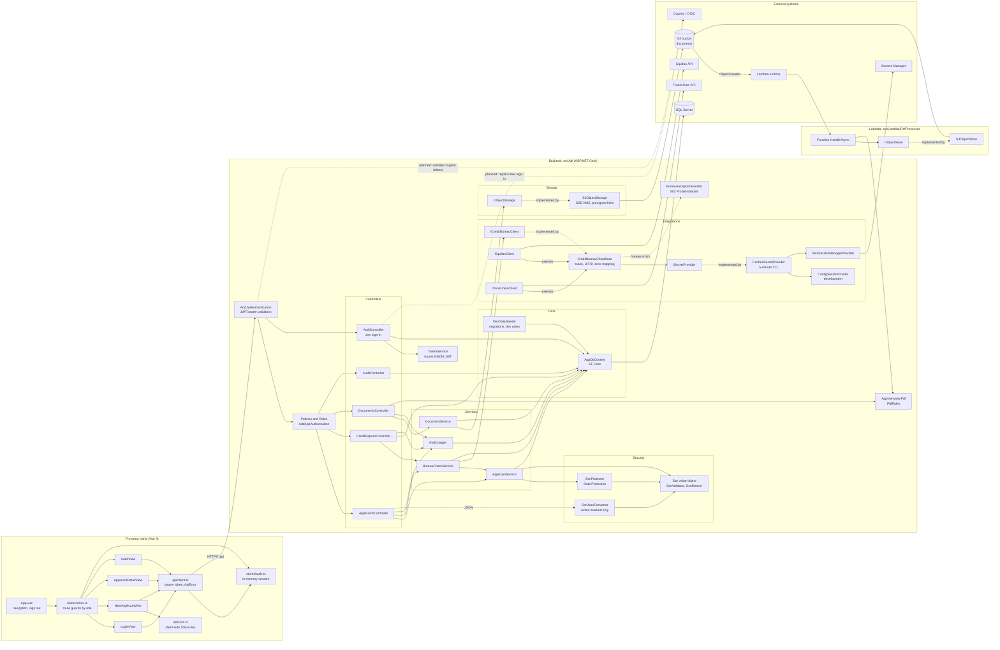

# Requirements coverage

Written for: reviewers checking the solution against [requirement.md](../requirement.md).

Each requirement maps to where it is implemented. Status is one of:

- **Done**: implemented and covered by tests or a live run.
- **Partial**: implemented locally, but a production piece is missing.
- **Planned**: designed and documented, not built.

## 1. Architecture and security diagrams

### 1.1 Production architecture (AWS), with security focus

Security checkpoints are numbered 🔒1–🔒14. The full list is in section 1.5.

Bureau calls leave the VPC through a NAT gateway with an egress allowlist 🔒14. The API runs under an IAM task role, so no access keys are stored in code, config, or images 🔒10. The SSN goes to bureaus only in the request body over TLS, and never appears in URLs, logs, or the browser 🔒5.

### 1.2 Localhost architecture

The same flow runs on a developer machine, with external services replaced by local emulators.

### 1.3 Deploy flow

Each environment has its own AWS account, Secrets Manager entries, and KMS key. GitHub Actions assumes an OIDC role per environment, so no long-lived AWS keys are stored in GitHub 🔒19.

### 1.4 Component diagram

Components as implemented in `web/`, `src/Api`, `src/Lambda/PdfProcessor`, and `src/Shared/AppInterview.Pdf`. Arrows point from the caller to the component it uses. The dashed box is planned, not built.

### 1.5 Security checkpoints

| # | Control | Where it is enforced |
|---|---|---|
| 1 | WAF rules, TLS at the edge | CloudFront + WAF |
| 2 | Private S3 bucket, origin access control | S3 static hosting |
| 3 | TLS 1.2+, HTTPS redirect, HSTS | ALB + API middleware |
| 4 | JWT validation (issuer, audience, expiry), MFA at IdP | API auth module, Cognito |
| 5 | SSN validation, masking, encryption at rest | `Ssn` value object, `SsnMasker`, data layer |
| 6 | Short-lived presigned URLs (≤5 min) | Documents module |
| 7 | Audit log, PII-free logging | Audit module, log masking |
| 8 | Role-based authorization policies | Controllers and policies |
| 9 | Encrypted database, KMS key | RDS |
| 10 | Secrets from Secrets Manager via IAM role, no secrets in code | `ISecretProvider` |
| 11 | Private networking, VPC endpoints | VPC |
| 12 | Block public access, SSE-KMS | S3 documents bucket |
| 13 | File type and size validation, PDF scan | Lambda PdfProcessor |
| 14 | Egress allowlist to bureau hosts | NAT / security groups |
| 15 | Required PR review, CODEOWNERS | GitHub branch protection |
| 16 | SAST (CodeQL) | CI |
| 17 | Dependency vulnerability and secret scanning | CI |
| 18 | Container and IaC scanning | CI |
| 19 | OIDC federation, least-privilege deploy role | Deploy pipeline |
| 20 | DAST and security sign-off | QA environment |
| 21 | Manual approval gate | Prod deploy |

### 1.6 Implementation status

| Item | Status |
|---|---|
| High-level production architecture, with security focus | Done (diagram 1.1) |
| Localhost architecture (LocalStack, WireMock, SQL Server) | Done (diagram 1.2) |
| Deploy flow (PR → CI → Dev → QA → Prod) | Done (diagram 1.3) |
| Component diagram of every frontend, API, Lambda, and external component | Done (diagram 1.4) |
| Numbered security checkpoints (21) | Done (table 1.5) |
| S3 storage of objects and PDFs, and Equifax and TransUnion retrieval, shown in the diagram | Done (diagrams 1.1 and 1.2) |

The same diagrams also appear in [architecture.md](architecture.md). The two copies are maintained by hand, so update both when a diagram changes.

## 2. Bureau integration and secret retrieval

| Requirement | Implementation | Status |
|---|---|---|
| Connect to external APIs using a token | `CreditBureauClientBase` fetches a bearer token through `ISecretProvider` and sends it on every call. See [CreditBureauClientBase.cs](../src/Api/Integrations/Bureaus/CreditBureauClientBase.cs). | Done (against WireMock stubs) |
| Credit report and employment status from Equifax and TransUnion | `EquifaxClient` and `TransUnionClient`, each mapping its own response shape into `CreditReport` and `EmploymentStatus`. | Done (against stubs) |
| Retrieve secrets | `ISecretProvider` with three implementations: `AwsSecretsManagerProvider`, `ConfigSecretProvider` (development), and `CachedSecretProvider` (5-minute TTL decorator). | Done |
| Secrets never in code or logs | Tokens are read at runtime. Secret values are never logged, and error messages name the secret, not its value. | Done |
| Bureau errors do not leak data | `BureauException` carries only the status code. `BureauExceptionHandler` returns a generic 502. | Done |

Real vendor API specs were not available, so the request and response shapes come from the WireMock stubs in `infra/bureau-mock/`.

## 3. SSN validation and masking

| Requirement | Implementation | Status |
|---|---|---|
| Validate SSN structure | `SsnValidator`: SSA rules (area not 000, 666, or 9xx; group not 00; serial not 0000), plus known sample numbers. Accepts dashes, spaces, or plain digits. | Done |
| Mask SSN for display | `SsnMasker` produces `***-**-1234`. `Ssn.ToString()` and the JSON converter always output the masked form. | Done |
| Full SSN never returned by the API | Responses use `MaskedSsn`. The full digits are `internal`, so only the bureau client can read them. | Done |
| Encrypt SSN at rest | `SsnProtector` uses ASP.NET Data Protection. Only the last four digits are stored in clear. | Partial: Data Protection keys are local, not KMS-backed |
| Lookup without storing plaintext | Not built. The plan called for a keyed HMAC hash. | Planned |
| Client-side validation mirrors server rules | `web/src/utils/ssn.ts`, with unit tests. The server remains authoritative. | Done |
| SSN kept out of the browser store | The SSN lives only in the form component and is cleared after submit. | Done |

## 4. Authorization and RBAC

### Roles

| Role | Purpose |
|---|---|
| `LoanOfficer` | Creates applicants, runs checks, uploads PDFs |
| `Admin` | All LoanOfficer actions, plus the audit log |
| `Auditor` | Read-only access to applicants, reports, and documents; views the audit log; cannot run checks or upload |

### Policies

| Policy | Allowed roles | Used by |
|---|---|---|
| `CanRunCreditCheck` | LoanOfficer, Admin | Create applicant, credit check, employment check |
| `CanViewReports` | LoanOfficer, Admin, Auditor | Get applicant, get credit report, get document, get download link |
| `CanManageDocuments` | LoanOfficer, Admin | Upload document |
| `CanViewAudit` | Auditor, Admin | Audit log |

A fallback policy requires an authenticated user for every endpoint that isn't marked `[AllowAnonymous]`. The only anonymous endpoint is the development sign-in. See [Policies](../src/Api/Security/Roles.cs) and [AuthorizationExtensions.cs](../src/Api/Security/AuthorizationExtensions.cs).

The web app's route guards and menu items mirror these policies. The API is the enforcement point.

Covered by tests: 401 for unauthenticated requests, 403 for the wrong role, and the masked-SSN checks on responses.

### Authentication

| Item | Implementation | Status |
|---|---|---|
| JWT bearer tokens | HS256, validated for issuer, audience, lifetime, and signature. 30-second clock skew. Claims are `sub` and `role`. | Done |
| Development sign-in | `POST /api/auth/token` returns 404 outside Development. Passwords are PBKDF2 hashes (ASP.NET Identity hasher). | Done |
| Production identity provider | Cognito or OIDC, as shown in the diagrams | Planned |
| Multi-factor authentication | Listed in the diagrams for the IdP | Planned |
| Signing key from a secret store | The key is in `appsettings.Development.json`. Production must load it from the environment or a secret store. | Partial |
| Browser token storage | The access token is held in memory only. | Done |

## 5. Data models

| Model | Purpose | Notes |
|---|---|---|
| `AppUser` | Operator account | Username is unique. Password is stored as a hash. |
| `Applicant` | Loan applicant | Encrypted SSN, last four digits, names, creation time. `MaskedSsn` is derived. |
| `CreditReportRecord` | Stored credit summary | Bureau, score, open accounts, total balance, retrieval time. |
| `DocumentRecord` | Uploaded PDF metadata | Server-generated S3 key, sanitized file name, size, uploader, time. |
| `AuditEntry` | Who did what, and when | Identifiers only, never SSNs or bureau payloads. |
| `CreditReport` | Bureau-neutral credit summary | Validates its own invariants (score 300–850, non-negative values). |
| `EmploymentStatus` | Bureau-neutral employment result | Not persisted; returned directly. |
| `Ssn` | Value object | Immutable. Equality ignores formatting. |

The database schema is in `src/Api/Data/Migrations/`, applied automatically in development. Production migration is a planned deploy step.

## 6. API controllers and endpoints

| Method and path | Policy | Purpose |
|---|---|---|
| `POST /api/auth/token` | Anonymous (development only) | Sign in, returns JWT |
| `POST /api/applicants` | CanRunCreditCheck | Create applicant. Response has masked SSN. |
| `GET /api/applicants/{id}` | CanViewReports | Get applicant |
| `POST /api/applicants/{id}/employment-check?bureau=` | CanRunCreditCheck | Verify employment |
| `POST /api/credit-reports/{applicantId}?bureau=` | CanRunCreditCheck | Run credit check and store the result |
| `GET /api/credit-reports/{id}` | CanViewReports | Get stored credit report |
| `POST /api/documents?applicantId=` | CanManageDocuments | Upload PDF |
| `GET /api/documents/{id}` | CanViewReports | Get metadata and processing status |
| `GET /api/documents/{id}/url` | CanViewReports | Get a download link that expires in 5 minutes |
| `GET /api/audit` | CanViewAudit | List the 200 most recent audit entries |

`bureau` accepts `equifax` or `transunion`. Any other value returns 400.

## 7. AWS S3 and Lambda

| Requirement | Implementation | Status |
|---|---|---|
| Store objects and PDFs in S3 | `S3ObjectStorage` with SSE-KMS, server-generated keys (`applicants/{id}/{guid}.pdf`) | Done (LocalStack) |
| Validate uploads | `PdfRules` checks the `%PDF-` signature, not the file name or Content-Type. Size limit 10 MB. | Done |
| Short-lived download links | Presigned GET, at most 5 minutes. The scheme follows the endpoint (HTTP for LocalStack, HTTPS otherwise). | Done (verified live on LocalStack) |
| Processing with Lambda | `PdfProcessor` runs on S3 ObjectCreated events, re-validates the object, and writes `processing` and `validation` tags. | Done (LocalStack) |
| Lambda tests | Six unit tests cover the accept and reject paths, oversized objects, empty objects, key decoding, and multiple records. | Done |
| Public access blocked, private bucket | Designed in the diagrams | Planned (infrastructure code) |

## 8. Frontend (Vue)

| Page or feature | Roles | Status |
|---|---|---|
| Sign in | All | Done |
| New applicant form with SSN input and masked display | LoanOfficer, Admin | Done |
| Applicant page: credit check, employment check, document upload, status, download | Varies by role | Done |
| Audit log | Auditor, Admin | Done |

Security in the frontend: content-security-policy meta tag, no `v-html`, token kept in memory, route guards by role.

Limitations: there are no list endpoints for applicants or documents, so the UI opens records by ID.

## 9. Security controls

| Control | Implementation | Status |
|---|---|---|
| Transport | HTTPS redirect in the API. TLS at the load balancer is planned. | Partial |
| CORS | Limited to the configured origin (`http://localhost:5173` in development) | Done |
| Error responses | ProblemDetails with no stack traces | Done |
| Input validation | `[ApiController]` model validation, SSN validation, PDF validation, `RequestSizeLimit` on upload | Done |
| SQL injection | EF Core parameterized queries | Done |
| Audit trail | `AuditLogger` records creates, checks, uploads, and download links | Done |
| Logs without personal data | Log messages carry identifiers only | Done |
| Dependency vulnerabilities | Vulnerable packages pinned to fixed versions. CI runs a dependency review. | Done |
| Secret scanning | gitleaks in CI | Done (CI, not run yet) |
| SAST | CodeQL in CI | Done (CI, not run yet) |
| Rate limiting | Not built | Planned |
| Security headers (HSTS, X-Content-Type-Options, and so on) | Not built | Planned |
| WAF | Shown in the diagrams | Planned |
| Network isolation (private subnets, VPC endpoints) | Shown in the diagrams | Planned |
| Least-privilege IAM | Designed for the task role and deploy role | Planned |

## 10. Deploy flow and environments

| Stage | Implementation | Status |
|---|---|---|
| PR and code review | Branch protection and CODEOWNERS are required, and the CI workflow runs on every PR | Partial: the rules must be set in GitHub |
| Build, test, and scan | [ci.yml](../.github/workflows/ci.yml): build and test API, type-check, test, and build web, CodeQL, dependency review, secret scan | Done (not run in GitHub yet) |
| Environments: Dev, QA, Prod | [deploy.yml](../.github/workflows/deploy.yml): jobs for each environment, gated by GitHub environment approval | Partial |
| OIDC access to AWS | The deploy workflow requests OIDC credentials | Partial: role ARNs are placeholders |
| Deploy steps | Placeholders (`echo "TODO"`) | Planned |
| DAST scan on QA | Placeholder step | Planned |

## 11. Local run

| Item | Status |
|---|---|
| API on `http://localhost:5000` | Done |
| Web app on `http://localhost:5173` | Done |
| SQL Server, LocalStack, and WireMock in Docker Compose | Done |
| Run instructions | [README.md](../README.md) |

## 12. Test coverage

| Suite | Tests | What it covers |
|---|---|---|
| `Api.Tests` (unit) | SSN rules and masking, bureau clients, secret caching, PDF rules, S3 presign scheme | Unit |
| `Api.Tests` (integration) | Endpoints under real auth and policies, on SQLite with stubbed bureaus and in-memory S3 | Integration |
| `PdfProcessor.Tests` | Lambda accept and reject paths | Unit |
| `web` | SSN validation and formatting | Unit |

Totals: 73 backend tests and 14 frontend tests.

Live checks run on the local stack: applicant creation with masking, Equifax and TransUnion checks against WireMock, PDF upload to LocalStack S3, Lambda processing with status `completed`, and a presigned link that downloads the file.

## 13. Known gaps

- Production deployment: infrastructure code, container images, and the deploy steps are not built. The AWS account, region, and infrastructure tool still need to be chosen.
- Production identity: Cognito or OIDC is designed but not integrated.
- Encryption keys: Data Protection keys are local. Production needs a KMS-backed key ring.
- Hash-based SSN lookup is not implemented.
- Rate limiting, security headers, and WAF are not implemented.
- The bureau integration has not been checked against the real vendor APIs.
