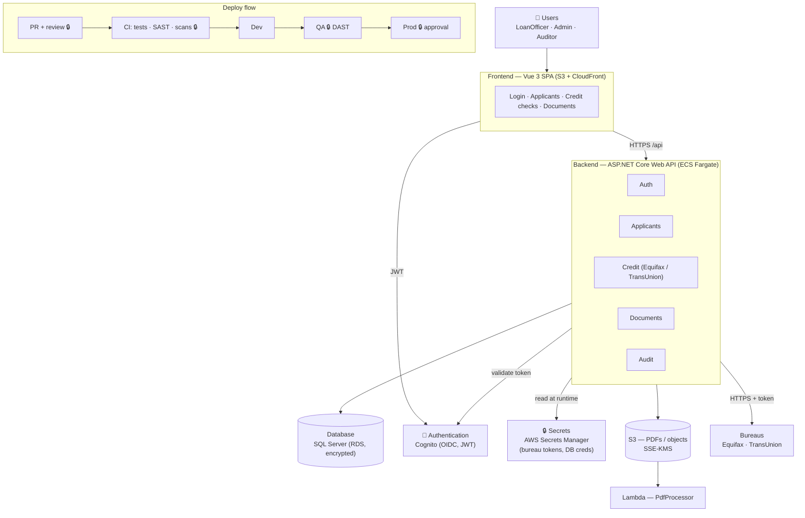

# Whiteboard (simplified)

Written for: an interview whiteboard session. Shows the main elements at a high level.

🔒 = security check. See [architecture.md](architecture.md) for the full numbered list.
